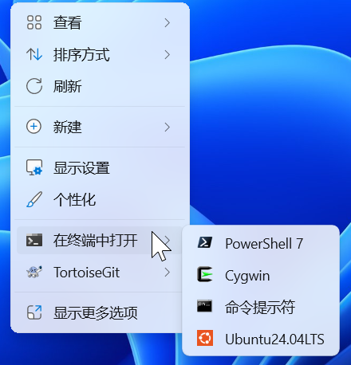

# Open In Terminal

在 Windows 11 文件资源管理器右键菜单中，选择 Windows Terminal 配置，在当前目录打开终端。支持 PowerShell、命令提示符、Git Bash、WSL 等，菜单内容随 Windows Terminal 配置自动更新。



## 安装与卸载

需要 **Windows 11** 和 **Windows Terminal**。

在本项目的 **Releases** 页面下载对应系统架构（x64 或 ARM64）的 `OpenInTerminal-版本号-架构-setup*.exe`，双击安装。安装器仅为当前用户安装，无需管理员权限。文件名带 `-dev` 的安装包需要先在 Windows 设置中开启“开发人员模式”。

安装时可勾选经典菜单，以便在 Directory Opus 或“显示更多选项”中使用。

更新时运行新版安装包；卸载时在 Windows“已安装的应用”中找到 **Open In Terminal**。

## 使用

- 右键文件夹或文件夹空白处，选择“在终端中打开”，再选择终端配置。
- 按住 **Ctrl** 再点击，以管理员身份打开终端。
- 多选文件夹时，每个目录打开一个终端窗口。
- 在 Windows Terminal 中调整配置名称、顺序、图标或隐藏状态，菜单会在约两秒后更新；关闭菜单后重新打开即可查看。

## 选择 Terminal 版本或自定义路径

默认使用 Windows Terminal 正式版。使用 Preview、Canary 或自定义安装位置时，创建 `%LOCALAPPDATA%\OpenInTerminal\config.json`：

```json
{
  "channel": "stable",
  "settingsPath": "",
  "terminalPath": ""
}
```

`channel` 可选 `stable`、`preview`、`canary`，路径留空时自动查找。绿色版或 Scoop 版本可将 `settingsPath` 设为 `settings.json` 路径，`terminalPath` 设为 `wt.exe` 路径。路径支持 `%LOCALAPPDATA%` 等环境变量；JSON 中的反斜杠需写成 `\\`。

源码构建、调试与打包请参阅[开发者指南](docs/development.md)。
